# Sparkline

Sparkline is a self-hosted dashboard for a small NVIDIA DGX Spark cluster. A lightweight agent on each
Spark samples the GPU, unified memory, CPU cores, ConnectX-7 links, NVMe and thermals once a second. A
console merges the nodes, keeps an alert timeline, runs whitelisted benchmarks and serves a web app that
answers one question at a glance: is the cluster healthy, and what is it doing? Sparkline shows only what
the hardware actually reports. Anything GB10 doesn't expose is labelled "not reported by this hardware",
never shown as zero.

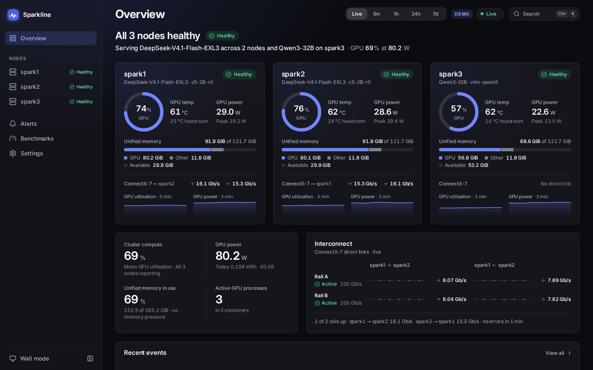

| | |
|---|---|
| 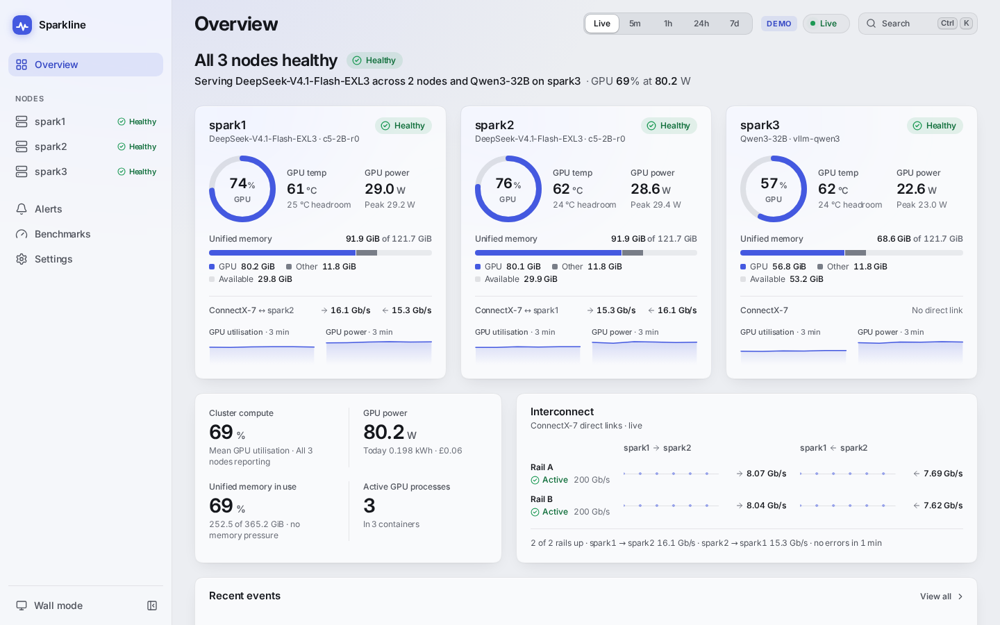 | 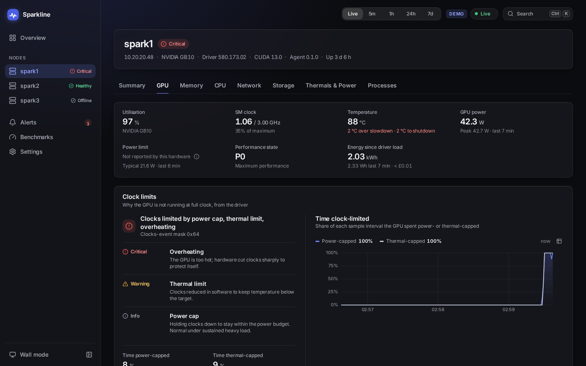 |
| 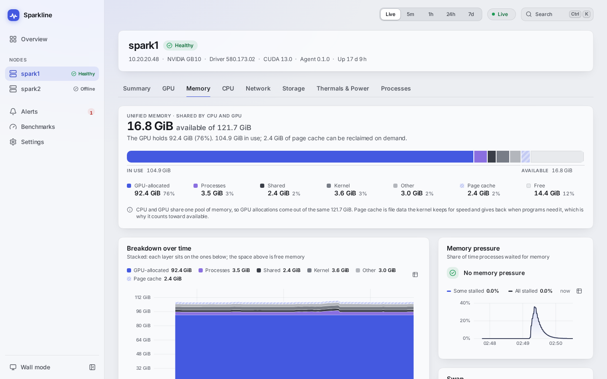 | 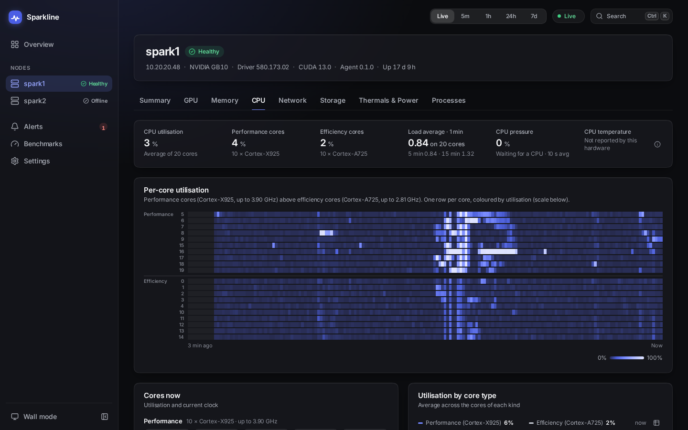 |
| 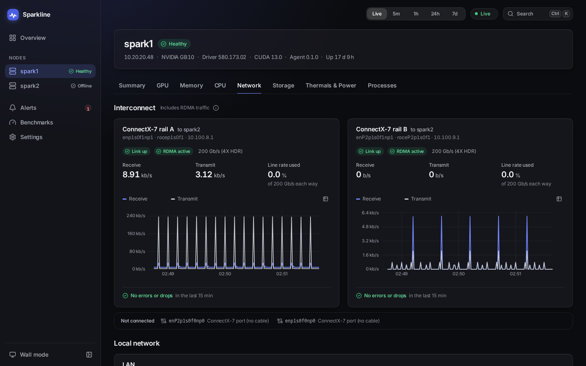 | 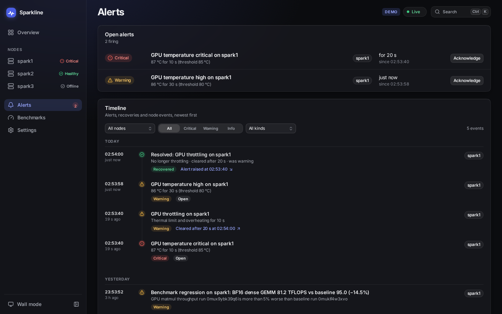 |
| 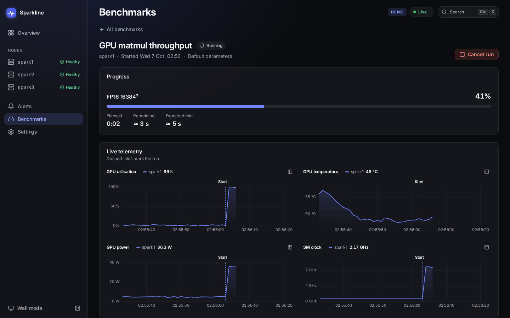 | 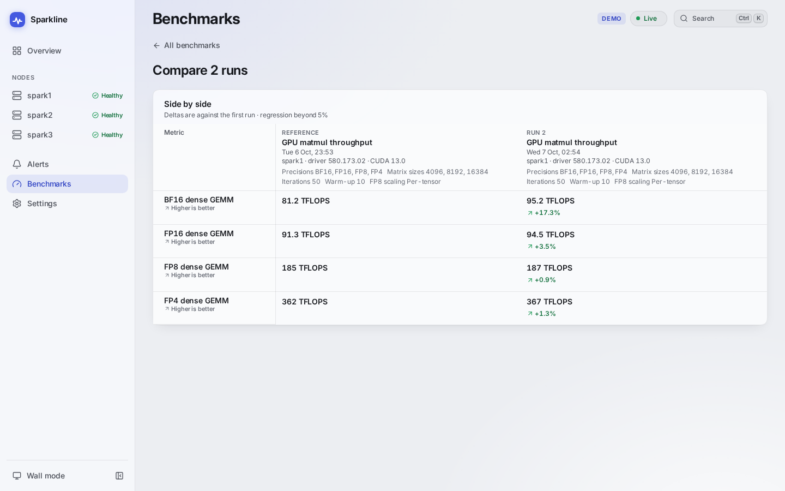 |
| 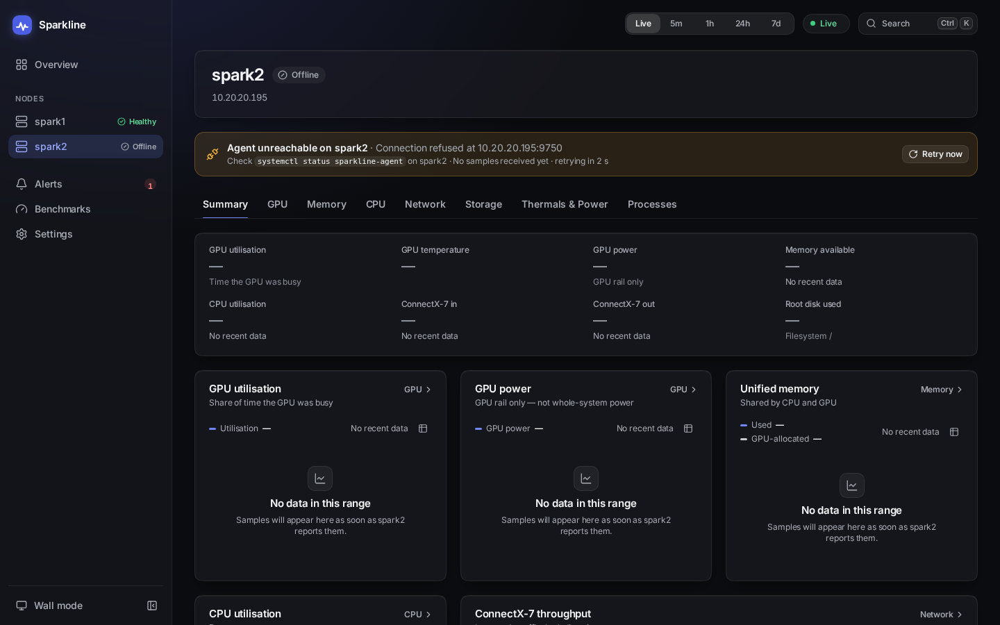 | 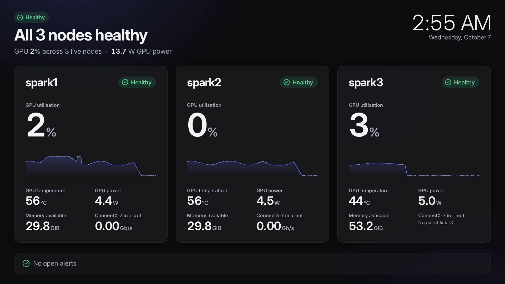 |

The memory, CPU, network and offline screenshots come from the real two-node cluster (taken while spark2's agent was
stopped). The others come from `--demo`, which can show load, a thermal episode and benchmark runs on demand.

## Features

- **Cluster overview.** Health of every node in one sentence, living node cards, total GPU utilisation, GPU
  power and today's energy, aggregate memory pressure, ConnectX-7 throughput between the nodes, recent events.
- **Node detail.** Tabs for GPU, unified memory, CPU, network, storage, thermals and power, and processes.
  Charts share a crosshair, support drag to zoom and double-click to reset, and have a time-range picker
  (Live, 5 m, 1 h, 24 h, 7 d). Every chart also has a text summary and a data-table view.
- **GPU (GB10).** Utilisation, SM and graphics clocks against their maximum, temperature against the
  slowdown and shutdown thresholds, power, energy, P-state, throttle reasons in plain English, the share of
  time spent power or thermal capped, and GPU memory per process.
- **Unified memory.** The headline memory story, because the CPU and GPU share it: used, available,
  GPU-allocated, process memory, page cache, shared, kernel, swap and PSI pressure.
- **CPU.** A per-core heatmap with the 10 Cortex-X925 performance cores and the 10 Cortex-A725 efficiency
  cores grouped apart, per-core frequency, and load averages.
- **Interconnect.** Link and RDMA state, rate, throughput both ways (including RDMA traffic, which bypasses
  the normal interface counters), and errors and drops for both ConnectX-7 rails, plus LAN throughput.
- **Alerts.** Editable thresholds (GPU temperature, throttling, memory, node offline, link down, disk full,
  NVMe temperature) and an event timeline with acknowledgement.
- **Benchmarks.** Eight whitelisted, parameter-validated jobs, from GEMM TFLOPS to a 30-minute thermal soak.
  Each one states its duration and impact up front, asks for confirmation, shows live telemetry while it
  runs, cancels cleanly, and saves results with full metadata. Baselines, regression flags, side-by-side
  comparison, JSON/CSV export and a shareable summary card are included.
- **Wall mode, command palette and keyboard shortcuts.** Dark and light themes that follow the system, with
  reduced-motion and reduced-transparency support.
- **Demo mode** (`--demo`): three simulated nodes, including a thermal episode, a stalled stream and a node
  that goes offline and comes back. No hardware or token needed.

## Quick start: the demo in two commands

With Docker, from the repo root:

```sh
docker build -f deploy/Dockerfile -t sparkline .
docker run --rm -p 127.0.0.1:9701:9700 sparkline --demo
```

Open http://127.0.0.1:9701. (The log's `Uvicorn running on http://172.17.0.x:9700` is the container's own
address; use the host port you published.) The demo needs no token, and its first minute is calm before
the scripted episodes start. Without Docker, follow the "Demo" section of
[DEV.md](DEV.md), which runs the same thing from a Python venv and a web build.

## Install the whole cluster in one command

On spark1, as your normal user, from the repo root (with `web/dist` built: `cd web && npm ci && npm run build`):

```sh
./deploy/install-cluster.sh            # add --dry-run first to see every action on both nodes
```

It installs `sparkline-agent` on spark1 and on its peer (ssh host `spark2`, override with `--peer`), with one
shared agent token and the ConnectX-7 `peers` filled in from each node's RDMA interfaces. It then installs the
console on spark1 and prints its URL (`http://<spark1 LAN IP>:9700`) and sign-in token. It asks for your sudo
password on each node. Benchmarks are enabled by default (`--no-benchmarks` for monitor-only agents). The steps
below do the same per node by hand.

## Install on the nodes (agent)

Run this on every DGX Spark. You need sudo, Python 3.12 or newer with `python3-venv` (or `uv`), and internet
access to PyPI for the Python dependencies.

```sh
git clone <this repo> sparkline && cd sparkline
sudo ./install.sh agent                       # monitor-only
sudo ./install.sh agent --enable-benchmarks   # also allow benchmarks (see Security)
```

The installer:

1. Checks the OS, architecture, Python version and NVIDIA driver. A missing driver is only a warning.
2. Creates the system user `sparkline`. It adds device groups only when `/dev/nvidia*` or the RDMA devices
   are not world-accessible (on DGX OS they are, so usually none).
3. Copies the code to `/opt/sparkline` and installs it into `/opt/sparkline/venv`.
4. Writes `/etc/sparkline/agent.toml` (mode 0640, root:sparkline) with a freshly generated token, but only if
   the file doesn't exist yet. It never overwrites config.
5. Creates `/var/lib/sparkline-agent` (0750) for history.
6. Installs, enables and starts `sparkline-agent.service`, then prints the agent's URL and token. The token
   is printed only on an interactive terminal; when the output goes to a file or a pipe, the installer prints
   where to read it (`sudo grep ^token /etc/sparkline/agent.toml`) instead.

All nodes and the console must share **one agent token**. Install the first node, then pass its token to the
others. To keep the token out of the process list, use the environment:

```sh
read -rs SPARKLINE_AGENT_TOKEN && export SPARKLINE_AGENT_TOKEN       # paste the token from the first node
sudo --preserve-env=SPARKLINE_AGENT_TOKEN ./install.sh agent
```

Re-running the installer is safe. It refreshes the code and units and restarts the service, and keeps the
config and data. The flags describe the state you want: running it again without `--enable-benchmarks`
turns benchmarks back off.

| Option | Meaning |
|---|---|
| `--enable-benchmarks` | Allow benchmarks: Docker access for the agent and lifted CPU/memory caps. Asks for confirmation. |
| `--agent-token TOKEN` | Use this token instead of generating one (or set `SPARKLINE_AGENT_TOKEN`). |
| `--bind ADDR`, `--port N` | Written into a new config. Defaults are `auto` and 9750 (agent) or 9700 (console). |
| `--prefix DIR` | Code and venv location (default `/opt/sparkline`). |
| `--dry-run` | Print every action and change nothing. Works without root. |
| `--destdir DIR` | Lay the files out under DIR, without users, ownership or systemd. For testing; works without root. |
| `-y`, `--yes` | Don't ask for confirmation. |

## Install the console

The console can run on one of the Sparks (spark1, say) or on any Linux box on the same LAN.

### With systemd

```sh
(cd web && npm ci && npm run build)    # the installer builds it for you if web/dist is missing and npm is found
sudo ./install.sh console --nodes spark1=http://10.20.20.48:9750,spark2=http://10.20.20.195:9750
```

The console's `agent_token` comes from `--agent-token` or `SPARKLINE_AGENT_TOKEN`. If neither is set and an
agent is installed on the same host, it is read from `/etc/sparkline/agent.toml`. Otherwise a new one is
generated, and the installer tells you to put it in each node's `agent.toml`. The installer prints the URL
to open and the console token you type on the sign-in screen.

### With Docker Compose

```sh
sudo install -d -m 0755 /etc/sparkline
sudo install -m 0640 -g 10001 deploy/console.example.toml /etc/sparkline/console.toml
sudoedit /etc/sparkline/console.toml           # tokens and [[nodes]]
docker compose -f deploy/docker-compose.yml up -d --build
```

The container runs as uid/gid 10001 with a read-only root filesystem, no capabilities and
`no-new-privileges`. It uses host networking, so `bind = "auto"` resolves to the host's LAN address just as
it does under systemd. Data lives in the `sparkline-data` volume. Tokens can come from `SPARKLINE_TOKEN` and
`SPARKLINE_AGENT_TOKEN` (exported, or in `deploy/.env` with mode 600) instead of the file.

### Uninstall

```sh
sudo ./install.sh uninstall           # stops and removes the services and /opt/sparkline
sudo ./install.sh uninstall --purge   # also deletes /etc/sparkline, all history and results, and the user
```

## Configuration

Config files are TOML. The agent reads `/etc/sparkline/agent.toml` and the console reads
`/etc/sparkline/console.toml`, unless `--config` or `SPARKLINE_CONFIG` names another file. Precedence is:
command-line flag, then `SPARKLINE_*` environment variable, then the file, then the built-in default.
Restart the service after editing: `sudo systemctl restart sparkline-agent` (or `sparkline`). Unknown keys in
`agent.toml` are rejected at start-up, so typos don't pass silently.

### agent.toml

| Key | Default | Meaning |
|---|---|---|
| `node_id` | short hostname | The node's own name (benchmark labels, logs). The console displays its `[[nodes]]` id, so keep the two the same. |
| `bind` | `"auto"` | IP to listen on. `auto` is the IPv4 address of the default-route interface. See Security. |
| `port` | `9750` | |
| `token` | `""` | Shared agent token, at least 16 characters. Required unless `bind` is loopback. |
| `interval_ms` | `1000` | Sample interval, 250 to 5000 ms. |
| `data_dir` | `/var/lib/sparkline-agent` if writable, else `~/.local/share/sparkline-agent` | SQLite history. |
| `ring_seconds` | `900` | In-memory recent history at full resolution. |
| `retention_10s_days` | `7` | Days of 10-second rollups. |
| `retention_60s_days` | `30` | Days of 1-minute rollups. |
| `procs_interval_s` | `5` | Process table refresh. It is the most expensive collector. |
| `peers` | `{}` | Far ends of the ConnectX-7 rails, so the link can be named. Example: `{ spark2 = ["10.100.8.2", "10.100.9.2"] }` |
| `include_virtual` | `false` | Also show virtual and Wi-Fi interfaces (docker0, tailscale0, ...). |
| `allow_public` | `false` | Allow binding a public address or 0.0.0.0. Avoid. |
| `bench_image` | `nvcr.io/nvidia/pytorch:26.07-py3` | Container image for GPU benchmarks. It must already be pulled. |
| `bench_work_dir` | `<data_dir>/bench-work` | Scratch for benchmark files. Keep it on the NVMe drive. Outside the data dir, it also needs a `ReadWritePaths=` drop-in. |
| `bench_payload_device` | `"cuda"` | `"cpu"` runs the GPU payloads on the CPU at tiny sizes: a code-path smoke test whose results are flagged and never compared. |

Agent flags: `--config`, `--bind`, `--port`, `--interval-ms`, `--data-dir`, `--token`, `--node-id`,
`--allow-public`, `--log-level`. Prefer the config file or the environment to `--token`, because the
process list shows command-line arguments to every user.

### console.toml

| Key | Default | Meaning |
|---|---|---|
| `bind` | `"auto"` | As for the agent. |
| `port` | `9700` | |
| `token` | `""` | What you type on the sign-in screen, at least 16 characters. Required except in `--demo` (and with no token, the demo has no sign-in). Changing it and restarting signs every browser out. |
| `agent_token` | `""` | Must equal `token` in every node's `agent.toml` (at least 16 characters). |
| `data_dir` | `/var/lib/sparkline` if writable, else `~/.local/share/sparkline` | `console.sqlite`: events, settings, benchmark results, sessions. `--demo` uses a `demo/` subdirectory, so simulated data never mixes with real data. |
| `web_dist` | `<repo>/web/dist` | The built web app. The installer sets `/opt/sparkline/web/dist`. |
| `[[nodes]]` | none | One table per agent: `id = "spark1"`, `url = "http://10.20.20.48:9750"`. |
| `[settings]` | see below | Initial values. Once you save in the app (Settings), the saved values in `console.sqlite` win. |
| `trusted_proxies` | `[]` | IPs or networks of reverse proxies whose `X-Forwarded-For` / `X-Forwarded-Proto` headers are believed, e.g. `["127.0.0.1"]` for a proxy on the same host. See Security. |

`[settings]` keys: `energy_rate_per_kwh` (0.28), `currency` ("£"), `stale_after_s` (5.0: a node with no
sample for this long is shown as stale), `offline_after_s` (30.0) and `regression_pct` (5.0: a benchmark
result worse than its baseline by more than this is flagged).

Console flags: `--config`, `--bind`, `--port`, `--data-dir`, `--web-dist`, `--allow-public`, `--log-level`,
`--demo`, `--demo-speed` (compress the demo's failure schedule) and `--demo-empty-bench` (demo without seeded
benchmark history).

### Environment variables

| Variable | Agent | Console |
|---|---|---|
| `SPARKLINE_CONFIG` | config file path | config file path |
| `SPARKLINE_AGENT_TOKEN` | `token` | `agent_token` |
| `SPARKLINE_TOKEN` | `token`, if `SPARKLINE_AGENT_TOKEN` is unset | `token` |
| `SPARKLINE_BIND` | `bind` | `bind` |
| `SPARKLINE_PORT` | `port` | `port` |
| `SPARKLINE_DATA_DIR` | `data_dir` | `data_dir` |

Empty values count as unset. `install.sh` also reads `SPARKLINE_AGENT_TOKEN`.

## Security model

Sparkline is built for a trusted LAN. It has no TLS of its own.

- **LAN-only binding.** `bind = "auto"` picks the private address of the default-route interface. Both
  services refuse to listen on 0.0.0.0, `::` or any public address unless you pass `--allow-public` (or set
  `allow_public` for the agent). Private means RFC 1918, 100.64.0.0/10 (CGNAT, which includes Tailscale),
  loopback, link-local and IPv6 ULA.
- **Tokens.** The browser signs in with the console token and receives an HttpOnly, SameSite=Strict session
  cookie, valid for 30 days (Secure when served over HTTPS). Scripts can send `Authorization: Bearer <token>`
  instead. The console talks to agents with the separate agent token; browsers never see it. Tokens are
  compared in constant time and must be at least 16 characters. Sign-in attempts and wrong bearer tokens
  are limited to 10 per minute per client IP, on the console and on each agent. State-changing requests
  whose `Origin` doesn't match the console are rejected. Sessions belong to the token that issued them:
  change `token` and restart the console, and every existing session is signed out.
- **Browser hardening.** Every console response carries a Content-Security-Policy (scripts, styles,
  connections and images from the console only; no framing), `X-Frame-Options: DENY`,
  `X-Content-Type-Options: nosniff` and `Referrer-Policy: same-origin`.
- **Secrets stay out of samples and logs.** The agent masks secret-looking command-line arguments before a
  process leaves the node (`--api-key`, `--hf-token`, `--password`, `--secret…`, `NAME_TOKEN=`/`NAME_KEY=`,
  `sk-…` and `hf_…` keys, URL passwords all become `***`). Both services mask `Authorization` and `Cookie`
  header values in their logs, even at `--log-level debug`. The LLM benchmark never copies an endpoint's
  response body into a run error (only an OpenAI-style error message), and refuses SSH, Docker API and
  Sparkline ports as endpoints.
- **An agent without a token** starts only on a loopback address, and then answers only local, non-browser
  requests.
- **No shell execution.** No endpoint runs commands. Benchmarks are a fixed registry, and every parameter is
  validated (enums, bounded numbers, pattern-checked strings, LAN-only endpoint URLs). Commands are built
  as argument lists, never through a shell. Each job runs in its own process group. Cancelling it sends
  SIGTERM, then SIGKILL after 5 s, removes its container and deletes its scratch files.
- **The docker group is root-equivalent.** GPU benchmarks start containers through the Docker socket, so
  `--enable-benchmarks` adds the agent to the `docker` group. Its unit gets a drop-in,
  `/etc/systemd/system/sparkline-agent.service.d/10-benchmarks.conf`. Anyone who controls a process in the
  docker group can control the host. Enable benchmarks only on machines where that trade-off is acceptable.
  Without the flag the agent is monitor-only: GPU benchmarks report Docker as unavailable, the host-side
  benchmarks (CPU, storage, RDMA, LLM) report the agent as CPU-capped, and container names in the process
  table fall back to short container ids.
- **systemd sandboxing.** Both services run as the unprivileged `sparkline` user, with no capabilities,
  `NoNewPrivileges`, a read-only filesystem except their state directory (`ProtectSystem=strict`), a private
  /tmp, a system-call filter, and network access limited to IPv4, IPv6, Unix and netlink sockets. The agent
  keeps device access for NVML and RDMA, and keeps full process visibility for the process table. The
  console has neither. The unit files explain each setting; run `systemd-analyze security sparkline-agent`
  to see the result.
- **Over the internet**, put the console behind a TLS reverse proxy or a VPN (Tailscale addresses count as
  private). Don't use `--allow-public`. Behind a proxy, set `trusted_proxies` to the proxy's address, so the
  session cookie is marked Secure and sign-in limits count each real client rather than the proxy. The proxy
  must pass the original `Host` header (the Origin check compares against it), set `X-Forwarded-For` and
  `X-Forwarded-Proto`, and forward WebSocket upgrades for `/api/v1/stream`. nginx: `proxy_set_header Host
  $host; proxy_set_header X-Forwarded-For $proxy_add_x_forwarded_for; proxy_set_header X-Forwarded-Proto
  $scheme; proxy_http_version 1.1; proxy_set_header Upgrade $http_upgrade; proxy_set_header Connection
  "upgrade";`. Caddy's `reverse_proxy` does all of this by default.

## What is measured, and what GB10 doesn't report

Everything shown was confirmed on the hardware: see [DISCOVERY.md](DISCOVERY.md) for the probe results and
where each value comes from (NVML, `/proc`, sysfs, ethtool, hwmon). The UI labels these as not reported by
this hardware:

- GPU power limit (so power is shown against its observed peak), memory clock, framebuffer memory, ECC, PCIe
  throughput and fan speed. NVML returns "Not Supported" for each on GB10.
- Per-core CPU temperature (there is no such sensor) and fans (none are exposed).
- Whole-system power. The only power sensor is the GPU rail, labelled "GPU power", and energy and cost are
  computed from it.

On ConnectX-7, inter-node traffic is RDMA and bypasses the kernel interface counters. Each rail's throughput
is therefore its netdev bytes plus its RDMA port counters (`port_rcv_data` / `port_xmit_data`).

## Benchmarks

Benchmarks run only when you confirm them in the console. One job runs per node at a time.

| Benchmark | What it measures | Default duration | Impact | Needs |
|---|---|---|---|---|
| GPU matmul (`gpu-matmul`) | Dense GEMM TFLOPS for BF16, FP16, FP8 and FP4 (NVFP4 on GB10; reported as unsupported elsewhere) | about 20 s | High: saturates the GPU | Docker + PyTorch image |
| Unified memory bandwidth (`mem-bandwidth`) | Copy/triad GB/s from the GPU and from the CPU (all, performance and efficiency cores) | about 10 s | Medium: slows running inference | Docker + PyTorch image |
| CPU throughput (`cpu-throughput`) | Single- and multi-core MB/s, per core type | about 25 s | Medium CPU, GPU barely affected | nothing extra |
| NCCL all-reduce (`nccl-allreduce`) | All-reduce bus bandwidth between the two nodes over the CX7 rails | about 10 s | Medium: stalls a TP=2 job | Docker + PyTorch image, 2 nodes |
| RDMA bandwidth and latency (`rdma-bw-lat`) | `ib_write_bw` / `ib_write_lat` over one CX7 rail | about 10 s | Low: saturates that rail | `perftest`, 2 nodes |
| NVMe storage (`storage-fio`) | Sequential 1 MiB and random 4 KiB read/write: MB/s, IOPS, p99 latency | about 35 s | Low, but heavy disk I/O | `fio` (optional) |
| LLM inference (`llm-inference`) | TTFT, prefill and decode tokens/s, memory footprint | seconds to minutes, depending on the model | Medium: real requests to your server | An OpenAI-compatible endpoint on the LAN |
| Thermal soak (`thermal-soak`) | Clock stability, throttling, temperature and TFLOPS drift under sustained load | 10 to 30 min | High: holds the GPU at full load | Docker + PyTorch image |

Notes:

- The PyTorch image (`bench_image`, default `nvcr.io/nvidia/pytorch:26.07-py3`) must already be pulled on
  each node. Until it is, the catalog marks the GPU benchmarks unavailable and shows the `docker pull`
  command. GPU containers need the NVIDIA Container Toolkit.
- NCCL uses `torch.distributed` with the NCCL backend inside the PyTorch container, because nccl-tests'
  `all_reduce_perf` needs an MPI launcher across nodes. It reports the same algorithm and bus bandwidth.
- Without `fio`, the storage benchmark uses a built-in O_DIRECT runner. The method is recorded with the
  results, and results from different methods are never compared. Install fio with `sudo apt install fio`.
- `sudo apt install perftest` enables the RDMA benchmark.
- Each result records driver, CUDA and NVML versions, GPU name and UUID, clocks and temperatures at start and
  end, agent version, the suite's git hash (when run from a checkout) and SHA-256, hostnames, parameters and
  timestamps.

### Typical results on a DGX Spark (GB10)

Measured on two idle DGX Sparks with the default parameters unless noted (2026-10-07). Use them to tell whether
your own run is in the right range; [DISCOVERY.md](DISCOVERY.md) has the spread, the cross-checks and the
caveats.

| Benchmark | Typical result |
|---|---|
| GPU matmul at 16384³ | BF16 ~99, FP16 ~98, FP8 (per-tensor scale) ~197, FP4 (NVFP4) ~347 TFLOPS. FP8 with per-row scales is much slower (~56) |
| Memory bandwidth | GPU copy / triad ~222 / ~224 GB/s (about 82 % of 273 GB/s). CPU ~120 GB/s for every core set; the efficiency set is level with or slightly ahead of the performance set |
| CPU throughput | ~246 MB/s per Cortex-X925 core, ~125 per Cortex-A725 core, ~2450 / ~1250 for each set of 10, ~3660 for all 20 |
| NVMe (built-in runner, 4 GiB) | sequential write ~5–8 GB/s, read ~8–9.5 GB/s; 4 KiB random ~12–18 k IOPS with 4 workers, ~110–185 k with 32 |
| RDMA, one rail | ~109 Gb/s write bandwidth at 64 KiB, ~1.45 µs latency |
| NCCL all-reduce, both rails | ~22.5 GB/s bus bandwidth at 1 GiB, ~13 µs for 8 B |
| Thermal soak, 10 min at 8192 | ~95 TFLOPS BF16, under 1 % drop first to last minute, ~81 °C peak, SM clock ~2.15–2.18 GHz, no throttle reasons |
| LLM inference | depends on your model and server; Qwen2.5-0.5B on vLLM decodes ~160 tokens/s per request |

Each CX7 rail is its own PCIe Gen5 x4 link (~109 Gb/s of payload), but both rails share one 200 Gb/s port: run
together they carry ~185 Gb/s, which is the ceiling NCCL reaches.

## Keyboard shortcuts

Press `?` in the app to see this list. Single-key shortcuts pause while you type, and can be turned off in
the same dialog.

| Keys | Action |
|---|---|
| ⌘K / Ctrl+K | Command palette: jump to nodes, metrics, benchmarks and actions |
| `?` | Show keyboard shortcuts |
| `g` then `o` / `a` / `b` / `s` | Go to Overview / Alerts / Benchmarks / Settings |
| `1` to `9` | Jump to node 1 to 9 |
| `w` | Wall mode |
| `t` | Cycle the theme |
| `Esc` | Close a dialog, leave wall mode |

## Troubleshooting

**"Agent unreachable on spark2".** On that node, run `systemctl status sparkline-agent` and
`journalctl -u sparkline-agent -n 50`. Check that the URL in `console.toml` uses the address the agent
listens on: the agent logs `listening on <ip>:9750` at start-up, and `curl http://<ip>:9750/healthz`
needs no token. A firewall must allow port 9750 from the console host.

**"Agent on spark2 rejected the console's token".** The console's `agent_token` doesn't match the agent's
`token`. Compare them with `sudo grep token /etc/sparkline/*.toml`, then restart whichever service you
changed.

**The service exits straight away.** A config problem exits with status 2, and systemd doesn't retry it.
`journalctl -u sparkline-agent` shows the reason: invalid TOML, an unknown key, a refused public bind, or a
missing token.

**GPU panels say "not reported" or show an NVML error.** Run `nvidia-smi` on the node. If the driver was
updated, reboot or reload it, then `sudo systemctl restart sparkline-agent`. If `/dev/nvidia*` isn't
world-readable on your system, re-run `install.sh agent` so it adds the owning group.

**No ConnectX-7 throughput or RDMA state.** Check `ibv_devinfo` and `ip -br link`. A rail is listed only when
its interface exists. Throughput needs `/sys/class/infiniband/<dev>/ports/1/counters/port_{rcv,xmit}_data`.
Port-wide discard and CRC counters come from ethtool and are shown once per physical port.

**Storage benchmark says fio is not installed.** That is informational: the built-in runner is used. Install
`fio` if you want fio's numbers.

**GPU benchmarks say Docker is unreachable or the image is missing.** Re-run
`install.sh agent --enable-benchmarks`, and `docker pull nvcr.io/nvidia/pytorch:26.07-py3` on the node.

**The page says "Frontend not built".** The console can't find `web_dist`. Build it with
`cd web && npm ci && npm run build`, or check `web_dist` in `console.toml`.

## Development

See [DEV.md](DEV.md) for running everything from the repo, the web dev server with hot reload, the demo,
and the checks (ruff, pytest, TypeScript, ESLint, Vitest, Playwright with axe). The design and wire
contract are in [PLAN.md](PLAN.md). The hardware findings are in [DISCOVERY.md](DISCOVERY.md).

## Architecture

```
  spark1                                  spark2
 ┌───────────────────────────┐           ┌───────────────────────────┐
 │ sparkline-agent  :9750    │           │ sparkline-agent  :9750    │
 │  collectors (NVML, /proc, │           │  collectors               │
 │   sysfs, ethtool, hwmon)  │           │  15 min ring buffer       │
 │  15 min ring buffer       │◄─ CX7 ──► │  SQLite 10 s / 1 min      │
 │  SQLite 10 s / 1 min      │  2×200G   │  benchmark runner         │
 │  benchmark runner         │           │                           │
 └─────────────┬─────────────┘           └─────────────┬─────────────┘
               │   REST + WebSocket, Bearer agent token (LAN)
               └───────────────────┬───────────────────┘
                     ┌─────────────▼──────────────┐
                     │ sparkline (console) :9700  │  merges nodes, stale/offline detection,
                     │  alerts + event timeline   │  reconnect with backoff, benchmark
                     │  benchmark orchestration   │  orchestration, results and baselines
                     │  console.sqlite, web app   │  (SQLite), serves the web app
                     └─────────────┬──────────────┘
                                   │  REST + WebSocket, session cookie or Bearer token
                     ┌─────────────▼──────────────┐
                     │ browser: React + TypeScript│  uPlot charts fed from typed-array
                     │  (Vite build, code-split)  │  buffers outside React; Zustand state
                     └────────────────────────────┘
```

One Python package (`server/`, package `sparkline`) provides both commands, `sparkline-agent` and
`sparkline`. The wire contract is `server/sparkline/common/schema.py`, mirrored in `web/src/lib/types.ts`.

## Limitations

- There is no built-in TLS. Use a reverse proxy or VPN if traffic leaves the LAN.
- One shared agent token covers all nodes. Rotating it means editing every `agent.toml` and the console's
  `agent_token`.
- Only GPU 0 is charted (a DGX Spark has one GPU). The cross-node benchmarks assume two nodes.
- GPU benchmarks need the PyTorch image already pulled, and the docker group (root-equivalent).
- Host-side benchmarks (CPU, storage, RDMA, LLM) run inside the agent's cgroup. Without
  `--enable-benchmarks` the agent is capped at half a core, so the catalog marks them unavailable ("CPU-capped",
  read from the cgroup's `cpu.max`) rather than letting a throttled run produce wrong numbers.
- Agents run on the host, not in containers: they need NVML, `/proc` and sysfs of the machine they measure.
- `install.sh` targets systemd-based Linux (DGX OS / Ubuntu 24.04) and needs PyPI access at install time.
